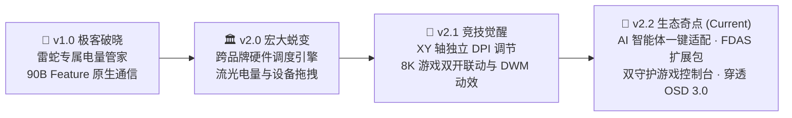
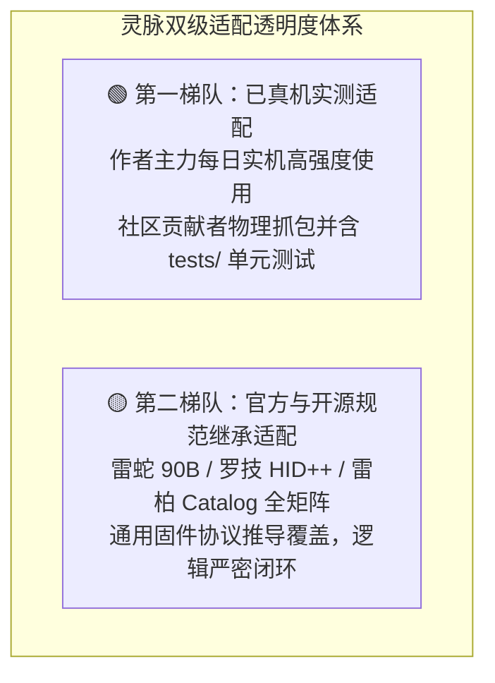

# ⚡ FerrisPulse · 灵脉 (跨品牌外设极客中枢与电竞优化感知引擎) v2.2.0

<p align="center">
  
</p>

<p align="center">
  <b>从一个鼠标，到一整张桌面 · 跨品牌直连 · 自动 8000Hz · AI 赋能外设生态</b><br>
  <i>专为雷蛇、罗技、索尼、NuPhy 及国产电竞外设打造的纯原生、零依赖 Windows 任务栏极轻量硬件调度中枢</i>
</p>

<p align="center">
  <a href="https://github.com/Ferris-echo/FerrisPulse/releases"></a>
  <a href="https://github.com/Ferris-echo/FerrisPulse"></a>
  <a href="https://github.com/Ferris-echo/FerrisPulse"></a>
  <a href="https://github.com/Ferris-echo/FerrisPulse"></a>
  <a href="https://github.com/Ferris-echo/FerrisPulse"></a>
  <a href="LICENSE"></a>
  <a href="https://signpath.io"></a>
</p>

---

## 📑 目录索引 (Table of Contents)
- [📖 灵脉诞生记与极客宣言](#-灵脉诞生记与极客宣言-the-philosophy)
- [🚀 灵脉全景进化史 (Milestones: v1.0 ➔ v2.2+)](#-灵脉全景进化史-evolution-milestones)
- [⚡ 六大核心杀手级特性 (Key Features)](#-六大核心杀手级特性-key-features)
- [📊 外设硬件适配全景兼容矩阵 (Compatibility Matrix)](#-外设硬件适配全景兼容矩阵-hardware-compatibility-matrix)
  - [🟢 级别一：已真机实测适配 (Tier 1: 物理抓包 / 每日主力实测)](#-级别一已真机实测适配-tier-1-verified-by-hardware--community-sniffing)
  - [🟡 级别二：官方与开源规范继承适配 (Tier 2: 协议推导 / 矩阵覆盖)](#-级别二逆向官方固件--开源社区协议规范继承适配-tier-2-adapted-via-official-reverse-engineering--open-specs)
- [🤖 AI 智能体专属外设适配指南 (做自己的开发者)](#-设备未被识别用-ai-agent-做自己的开发者-ai-powered-adaptation)
- [🛡️ 反作弊与安全性保障 (Anti-Cheat & Security FAQ)](#-反作弊与安全性声明-anti-cheat--security-faq)
- [🏆 极客殿堂 · 社区硬核贡献者名录 (Hall of Fame)](#-极客殿堂--社区硬核贡献者全量名录-hall-of-fame--contributors)
- [🛠️ 本地极速编译构建 (Build from Source)](#-本地编译与构建-build-from-source)
- [📄 开源许可证与极客约定 (License)](#-开源许可证-license)

---

## 📖 灵脉诞生记与极客宣言 (The Philosophy)

> **“为什么我们必须忍受动辄 1GB、常驻 10+ 后台守护服务的流氓外设驱动？”**

每一位 PC 玩家和极客都曾经历过这样的痛苦：  
为了看一眼无线鼠标还剩多少电，或者在进游戏时切换一下 4000Hz/8000Hz 回报率，你不得不安装 **Razer Synapse (雷云)、Logitech G HUB、ASUS Armoury Crate (奥创中心)** 等官方驱动全家桶。它们不仅体积极其臃肿、开机拖慢系统数十秒、在后台常驻无休止的遥测上报，还常常引发微操掉帧与蓝屏崩溃。

**FerrisPulse · 灵脉**（原名《雷蛇电量管家》）因此而生：
* ❌ **拒绝臃肿驱动全家桶**：彻底干掉官方庞杂的后台守护与常驻服务；
* ❌ **拒绝 Electron / Webview 伪桌面应用**：不使用任何浏览器内核或庞大第三方依赖包；
* ✅ **坚守纯血 Windows 原生哲学**：全量代码基于 **C# 5.0 与 .NET Framework 4.0** 纯原生开发，调用 Win32 底层 API 与 HID 报文通信；
* ✅ **极速轻巧与零负担**：软件编译后为极其精悍的单文件，常驻内存仅约 **12.8 MB**，CPU 占用长期 **0.00%**，冷启动 **< 200ms**，解压即用！

---

## 🚀 灵脉全景进化史 (Evolution Milestones)

灵脉历经多个重大版本跃迁，从最初单一品牌的电量工具，逐步成长为业内领先的跨品牌底层硬件中枢：



* **🌱 v1.0 时代 · 极客破晓**：
  - 深度逆向雷蛇私有 90 字节 Feature Report 协议，实现免雷云毫秒级读取无线电量；
  - 创造 Windows 原生彩色托盘电量渲染算法，打破官方驱动垄断。
* **🏛️ v2.0 时代 · 宏大蜕变**：
  - 解构罗技 HID++ 1.0/2.0+、漫步者 EC 协议、NuPhy 矮轴/磁轴固件、CompX 国产公版方案；
  - 正式升级为 **跨品牌外设统一调度引擎**，支持任务栏流光电量、多设备拖拽自定义排序与智能静置休眠感知。
* **🎯 v2.1 时代 · 竞技觉醒**：
  - **业内首创 XY 轴灵敏度独立调校**：支持 X 轴与 Y 轴分离调节，内置 1:1、4:3 (75% 垂直控枪)、16:10 等比联动预设；
  - **全屏游戏自动优化双开联动**：进游戏自动拉满电竞 DPI 与最高 8000Hz 超高回报率，退游戏自愈恢复常规桌面参数；
  - **Windows 原生弹窗展开动效**：基于 DWM 呈现原生平滑微光展开缩放，消灭浅色底白框闪烁；全档位低回报率（125~500Hz）节能支持。
* **🤖 v2.2 时代 · 生态奇点 (当前版本)**：
  - **做自己的开发者 (AI-Powered Adaptation)**：首创外设硬件向导 AI 智能体专属卡片，提供完整定制版 Prompt 与全工程中英双语逆向指南；
  - **双模硬件扩展包系统 (FDAS)**：确立三级驱动注册表 (`*.fp-driver.cs` Priority 300 > `*.fp-adapter.json` Priority 200 > 内置驱动 Priority 100)；
  - **电竞游戏进程控制台**：全新的左右双栏管理页面，支持“进程存活常驻模式”与“仅前台激活模式”双策略，全屏 D3D 通用兜底探测；
  - **全屏双开战术 OSD 3.0 & 三锁指示器**：双轴大字号战术 HUD、零焦点穿透防吞枪、Caps/Num/Scroll Lock 屏幕轻量状态 HUD；
  - **全局无级平滑缩放体系**：支持 80% ~ 200% 等比矢量缩放，高分屏超清呈现。

---

## ⚡ 六大核心杀手级特性 (Key Features)

### 1. 跨品牌外设硬件直连与大一统调度
* **20+ 顶级品牌全面覆盖**：雷蛇 (Razer)、罗技 (Logitech)、索尼 (Sony)、漫步者 (EDIFIER)、NuPhy (努斐)、华硕 (ROG)、VGN/VXE (蜻蜓)、造品 (Zaopin)、ATK、雷柏 (Rapoo)、迈从 (MCHOSE)、盖世小鸡 (GameSir)、高斯 (GANSS)、宏碁 (Acer) 等；
* **深解私有协议**：解析雷蛇 90 字节双向报文、罗技 HID++ 2.0/4.5 寄存器、索尼 64 字节 HCI 双向协议、漫步者 EC 报文掩码解密、CompX 锂电放电拟合等。

### 2. 8000Hz 竞技感知与电竞游戏常驻守护
* **毫秒级极速升频**：进入《无畏契约》《CS2》《Apex 英雄》《永劫无间》等游戏瞬间，自动将鼠标硬件回报率秒切至 4000Hz/8000Hz，并自动切换为预设的电竞专属 DPI 档位；
* **双模式守护策略**：
  - **进程存活常驻模式 (官方推荐)**：只要游戏在后台存活，切屏查攻略、看直播、看时间绝不反复切鼠标档位；彻底退出游戏后才自愈恢复桌面常规参数；
  - **仅前台窗口激活模式**：仅当游戏位于最顶层活动窗口时生效，带 1200ms 防抖安全切换；
* **通用全屏 D3D 兜底探测**：基于 Win32 `SHQueryUserNotificationState`，未加入名单的全新游戏亦可自动捕获。

### 3. 业内领先的 X / Y 轴灵敏度独立调校与控枪预设
* **分离式调校**：彻底打破传统驱动横纵 DPI 强绑定的限制，支持水平与垂直灵敏度独立设定；
* **FPS 电竞专属比例胶囊**：内置 `1:1`、`4:3 75%` (纵向微操垂直压枪强化)、`16:10 90%`、`1.33x` 等比锁定胶囊，调节任意轴自动按黄金比例等比同步；
* **硬件级实时回读**：屏幕悬浮战术 HUD 与主界面双轴自适应呈现（如 `● 硬件生效: 4000 Hz · 3000×2250 DPI`）。

### 4. 极致纯血原生、零开销与绿色安全
* **真·纯原生架构**：严格遵循 C# 5.0 / .NET Framework 4.0 语法基准，仅依赖系统核心程序集，零外部 NuGet，零第三方 DLL；
* **极度轻巧**：内存常驻仅约 **12.8 MB**，CPU 占用长期 **0.00%**，启动耗时 **< 200ms**；
* **100% 反作弊安全**：不挂任何 API Hook，不注入任何游戏 DLL，零内存读写，完全符合 Riot Vanguard、Valve VAC、Easy Anti-Cheat (EAC) 审核标准。

### 5. DWM 原生微光美学与全功能交互体验
* **Windows 原生平滑展开动效**：基于 DWM 与句柄重构，托盘呼出时完美呈现与 Windows 原生浮窗一致的平滑微光缩放展开，彻底消灭浅色底白框闪烁；
* **全局无级平滑缩放体系**：支持 80% ~ 200% 任意矢量级平滑缩放，4K/高分屏视网膜级锐利文字；
* **任务栏动态流光电量**：多色/单色像素级实时光标指示，支持多设备轮播；
* **三锁状态浮动 HUD**：实时感知 Caps Lock、Num Lock、Scroll Lock 状态并呈现沉浸式 HUD。

### 6. 开放外设生态 (FDAS) 与 AI 智能体一站式赋能
* **三级优先级驱动注册表**：
  - 优先级 300：`*.fp-driver.cs`（C# 强类型动态编译驱动，支持深度逻辑与专属算法）；
  - 优先级 200：`*.fp-adapter.json`（JSON 声明式硬件适配包，简单配置即可点亮设备）；
  - 优先级 100：`BuiltInDrivers`（内置原生核心驱动引擎）。
* **做自己的开发者**：外设向导内置一键复制定制版 Prompt，配合中英双语指南让 DeepSeek、Antigravity 等智能体轻松完成新设备逆向适配。

---

## 📊 外设硬件适配全景兼容矩阵 (Hardware Compatibility Matrix)

灵脉严格恪守 **“物理事实优先”** 铁律，公开透明地区分各设备型号的适配级别：



---

### 🟢 级别一：已真机实测适配 (Tier 1: Verified by Hardware & Community Sniffing)
> **技术准则**：由开发者本人作为主力设备每日高强度实测，或由社区贡献者通过物理真机、USBPcap/Wireshark 完整捕获确凿的 TX/RX 十六进制报文，并在 `tests/` 测试套件中**配备独立真实回放测试脚本**。绝无空想猜测，100% 物理事实还原。

| 品牌 / 协议族 | 实测覆盖型号范围 | 支持的核心功能与实测亮点 |
| :--- | :--- | :--- |
| **雷蛇 (Razer)** | **DeathAdder V4 Pro / DeathAdder V4 Pro Carbon**（`00BE`/`00EF`）<br>**Viper V4 Pro**（`00E5`）<br>**BlackShark V2 Pro 旋风黑鲨 2.4G (2023款)**（`0555`）<br>**Kraken V4 北海巨妖 V4**（`056C`）<br>**Viper V3 HyperSpeed**（`00B8`）<br>**Viper V2 Pro 黑白双色版**（`00A6`/`00A5`）<br>**DeathAdder V2 X HyperSpeed**（`009C`） | 1% 精确物理电量、充电感知、**双向板载 DPI 读写 (支持 XY 轴独立调节)**、**回报率档位极速切换 (最高 8000Hz)**、**板载全部 8 个硬件按键映射读写**、无 Feature 限制 64 字节中断端点 PA/PI 通信。 |
| **NuPhy (努斐)** | **NuPhy WH80 三模磁轴键盘**<br>**NuPhy Air75 V2**<br>**NuPhy Halo75 V2** | 键盘智能休眠超时调节、WinLock 锁、RGB 背光与无级亮度动态控制、1% 物理电量直读与充电感知。 |
| **迈从 (MCHOSE)** | **A5 V2 Ultra 8K 电竞鼠标**<br>**G75 PRO 机械键盘** (`3554:FA09`)<br>**G87 V2 机械键盘** (`3837:3033`)<br>**Z75S 三模机械键盘** (`258A:01BB`) | 1% 真实电量、CompX 公版协议与内置触控板精确物理隔离、**XY 轴独立 DPI**、**8K 回报率写入 (125~8000Hz)**、20 字节状态帧与专属休眠缓存状态机。 |
| **索尼 (Sony)** | **INZONE Buds 无线入耳** (`054C:0EC2`)<br>**INZONE H5 头戴电竞耳机** (`054C:0EBF`)<br>**PULSE Explore TWS 电竞耳机** (`054C:0ECC`/`0ED0`)<br>**DualSense Edge PS5 无线精英手柄** (`054C:0DF2`) | **左耳、右耳、充电盒独立三路 1% 物理电量**、索尼私有 HCI 封装解析、2 字节载荷自适应单路电量、Feature Report `0xB0` 双耳 16 级电量、**PS Link 与 USB 充电盒双通道内存合并**、手柄 10% 物理档位与充电感知。 |
| **罗技 (Logitech)** | **G502 X PLUS 旗舰无线鼠标** (`046D:C095`)<br>**G304 / C53F 经典无线鼠标**<br>**G PRO X Wireless 旗舰无线电竞耳机** (`046D:0ABA`) | 解决双端点竞争与短报告崩溃、20 字节 HID++ 2.0 握手、**Feature 0x2201 Func 2 真实 DPI 寄存器直读**（彻底消除 200 DPI 偏差）、HID++ 4.2 专属 `0x1F20` ADC 毫伏放电曲线拟合算法。 |
| **漫步者 (EDIFIER)** | **花再 Halo Space 极光空间头戴耳机** (`2D99:E049`) | 64 字节 EC 私有协议、`XOR 0xA5` 载荷掩码解密、累加和校验算法，真实读取耳机电量、固件版本、设备名称与蓝牙 MAC 地址。 |
| **华硕 (ASUS ROG)** | **ROG 夜魔 (Azoth) 客制化机械键盘**<br>**ROG PELTA 无线游戏耳机** (`0B05:1B84`)<br>**ROG 游侠 Scope II RX / 96 Wireless** (`0B05:1AB5`) | 穿透 ROG Omni 接收器 (`1ACE`) 握手配对 `1A85`、64/65 字节专用控制通道，直接读取键盘与耳机的实时物理电量与充电状态。 |
| **VGN / VXE (蜻蜓)** | **蜻蜓 3 Pro 游戏鼠标** (`391D:1A03`)<br>**Neon75 客制化机械键盘** (`3151:5038`) | Yjx 易捷讯私有协议、65B 中断 OUT `0x30` 查询与 **8000Hz 读写**、65B 中断 `0xF7` 状态帧与 Bit7 校验和，**彻底根除拔线仍显示 100% 充电的假死 Bug**。 |
| **造品 (Zaopin)** | **Zaopin Z2 三模电竞鼠标** (`3554:F526`/`F527`) | CompX 协议隔离 1K/4K 双 PID，基于官方 **21 阶锂电池放电曲线与 12mV 步进**精准电压拟合，定制 Zaopin 官方橙色主题。 |
| **宏碁 (Acer)** | **OMR331 / R332 旗舰无线鼠标** | 连续 4 天实机抓包对比，纠正状态位 `[15]`，精准锁定充电标志位 `[13]` 与真实电量 `[14]`，实现防伪充电跳变修正。 |
| **ATK / 怒喵 / 玄派** | **ATK V75X 机械键盘** (`320F:5088`)<br>**ATK A9 AIR 8K** (`1279`) & **X1 V2 8K** (`12E9`)<br>**怒喵 AM Infinity .97 客制化键盘**<br>**玄派玄熊猫 P1 (1K / 4K / 有线)** | `0xFF1C/0x0092` 64B 端点 0x1A 真实电量与灯效控制、解决 8K 接收器丢包重构为异步 8000Hz 读写、62B RACE 协议与 0x30CF 状态查询、17B 专用协议与 4000Hz 切换。 |
| **雷柏 / 高斯 / 小鸡 / 赛睿** | **雷柏 VT3 系列双模鼠标** (`1412` 等)<br>**高斯 GS3108T-PRO 三模机械键盘**<br>**盖世小鸡 启星 2 / Nova 2 双模手柄**<br>**赛睿 Arctis Nova 5 / Nova 5X 2.4G 耳机** | 19 字节遥控帧实现 6 档自定义 DPI 与 **XY 轴独立 DPI 硬件同步**、`0x0C45` 通用 `0x05/0x11` 协议帧提取电量、`UsagePage 0xFFA0` 专用端点读取状态与 MAC 绑定、`0x00B0` 状态帧直读。 |

---

### 🟡 级别二：逆向官方固件 / 开源社区协议规范继承适配 (Tier 2: Adapted via Official Reverse Engineering & Open Specs)
> **技术准则**：基于品牌官方驱动底层报文体系（如雷蛇 90 字节 Feature 架构、罗技 HID++ 2.0/4.5 标准寄存器、雷柏 Catalog 族谱、NuPhy / Valkyrie 通用固件接口）完成逆向实现与全矩阵覆盖。协议严密闭环，但由于 SKU 过多，未对该系列下的每一个长尾型号进行真机打标。

| 品牌 / 协议族 | 覆盖型号范围 | 支持的核心功能与实现方式 |
| :--- | :--- | :--- |
| **雷蛇 (Razer) 键鼠大矩阵** | **炼狱蝰蛇系列**：DeathAdder V3 Pro、V3 HyperSpeed、V3 有线 8K、V2 Pro、V2 Mini、V4 HyperSpeed<br>**毒蝰系列**：Viper V3 Pro、Viper V3 HyperSpeed、Viper Mini Signature Edition、Viper Ultimate、Viper 8K<br>**巴塞利斯蛇系列**：Basilisk V3 Pro 35K / 幻影绿、Basilisk V3 35K、Basilisk V3 Pro、Basilisk Ultimate、Basilisk X HyperSpeed<br>**那伽梵蛇/眼镜蛇/八岐大蛇**：Naga V2 Pro、Naga Pro、Cobra Pro、Orochi V2、Atheris、官方无线充底座 Mouse Dock Pro 等 | 毫秒级 1% 真实电量读取、充电状态感知、**双向板载 DPI 读写 (支持 XY 轴独立分离调节)**、**回报率档位切换 (最高 8000Hz)**、断线平滑自愈。 |
| **罗技 (Logitech) Lightspeed 矩阵** | **GPW 全家族**：GPW 1/2/3/4/5（PRO X SUPERLIGHT 1/2/2 DEX/2C/SUPERSTRIKE、PRO 2）<br>**G502 全家族**：G502 LIGHTSPEED、G502 HERO、Proteus Spectrum<br>**主流与办公鼠标**：G309 LIGHTSPEED、G703、G903、G604、G603、G203/G102、MX Master 3/3S、MX Anywhere 3<br>**键盘与耳机**：G913 / G913 TKL、G915 X、G515 TKL、G PRO X 60、MX Keys / Mini；G733、G533、G435、G935 | HID++ 2.0/4.5 寄存器握手、1% 精确物理电量、**DPI 档位读写**、**回报率切换 (最高 8K)**、充电状态与板载电池电压监控。 |
| **雷柏 (Rapoo) VT 矩阵 (70+ 款)** | **VT1 全系列**：VT1、VT1 MAX、VT1 PRO、VT1 SE、VT1S MAX V2<br>**VT7 全系列**：VT7、VT7S、VT7 MAX、VT7 PRO V2、VT7 Air MAX、VT7 SE<br>**VT9 全系列**：VT9、VT9 Pro、VT9S、VT9 Air、VT9 MAX MASTER、VT9S PRO V2<br>**VT2 / VT0 / VT6 / VT8 全系** 及 V300 Pro / V300SE 等 | 私有 64B HID 协议、1% 真实电量、**DPI / 独立回报率切换 (1K/4K/8K)**、有线与 2.4G 双模智能拓扑映射。 |
| **瓦尔基里 (Valkyrie) 全矩阵** | **机械键盘**：VK 99 全系 (Max/Ultra/Gaming/V2)、VK 87 全系、VK 75 Pro、VK MAG75/68、Mecha 75、NB68 等<br>**电竞鼠标**：VK M5 全系 (Lite/Pro/EVO/Super/Ultra/MAX)、VK M7 PRO、VK M4、VK M3 | 瓦尔基里私有 HID 控制帧、物理电量、充电感知、休眠状态探测。 |
| **NuPhy (努斐) 客制化系列** | Air60 V2 / Air96 V2、Halo96 V2、Field75 | 键盘休眠超时调节、WinLock 锁、RGB 背光与无级亮度控制、电量与充电状态直读。 |
| **VGN / VXE 蜻蜓系列** | Dragonfly F1 / F1 Pro / F1 Pro Max / F1 MOBA、Dragonfly F2 Pro Max、VXE R1 全系 | CompX 方案 1% 物理电量读取、充电判定、电竞模式联动。 |
| **苹果 (Apple) 生态** | AirPods 1/2/3/4、AirPods Pro 1/2 (Lightning/Type-C)/3、AirPods Max | 双耳独立电量、充电盒电量、充电状态判定。 |
| **开源电竞通用协议 (OpenMouse)** | 采用原相 PAW3395/3950 + 诺迪克 Nordic/维盛公版固件的国产客制化 64B/65B 鼠标 | 自动探测 Vendor 接口电量与基础回报率（强制锁定 `SupportsDpi = false` 避免盲发写指令）。 |

---

## 🤖 设备未被识别？用 AI Agent 做自己的开发者！(AI-Powered Adaptation)

找不到你的设备？**试试自己做自己的开发者！**  
在灵脉中，我们已经打通了 **AI 智能体专属外设适配链路**。你可以借助本地 AI Agent（如 DeepSeek Harness、Tencent Workbuddy、Google Antigravity、OpenAI Codex 等），让智能体直接阅读我们的工程源码并自动探测物理连接的外设通信报文与电量指令，完成一站式极客适配！

* 🚀 **一键复制定制版 Prompt**：在主界面点击「添加设备」向导，即可一键复制为你的智能体量身定制的硬件逆向提示词；
* 📖 **工程经验飞轮传承**：提示词强制前置通读 `docs/AGENT_HANDBOOK.md`，使外部智能体全盘继承 13 大底层铁律，杜绝踩坑；
* 👉 **查看中英双语完整指南：[AI 智能体专属外设适配指南 (docs/AI_DEVICE_ADAPTATION_GUIDE.md)](docs/AI_DEVICE_ADAPTATION_GUIDE.md)**

---

## 🛡️ 反作弊与安全性声明 (Anti-Cheat & Security FAQ)

> **问：在《无畏契约 (Valorant)》《CS2》《Apex 英雄》《永劫无间》等高强度竞技游戏中使用会被封号吗？**

**答：绝对不会。100% 绿色安全。**
1. **纯标准 Windows API 查询**：灵脉仅使用操作系统官方公开的 `user32.dll` 校验当前前台活动窗口（如同 OBS 游戏捕获或 Discord 游戏状态识别），**绝无对游戏进程调用 `OpenProcess`，不读取/修改游戏内存**；
2. **纯标准 HID 特征报文**：切换 DPI 与回报率时，向硬件发送的是厂商官方公开支持的端点指令，**与你在官方驱动界面点击切换档位完全一致**；
3. **零驱动级/内核级敏感行为**：本程序没有安装任何底层驱动劫持，不挂任何 API Hook，不注入任何 DLL，全量源码完全开源接受全球安全审计。

---

## 🏆 极客殿堂 · 社区硬核贡献者全量名录 (Hall of Fame & Contributors)

**FerrisPulse · 灵脉** 的茁壮成长，离不开每一位开源极客的无私奉献与硬核探索！  
在此特别向以下为主干贡献代码、深度协议抓包、逆向推演与底层排查的先锋极客致以最崇高的敬意：

| 极客贡献者 | 核心适配设备 / 缺陷修复与功能贡献简解 |
| :--- | :--- |
| **[@Q-LL](https://github.com/Q-LL)** | 适配索尼 **PULSE Explore** 耳机、**DualSense Edge** 手柄与 **ATK V75X** 键盘；纠正雷蛇 **Viper V2 Pro** 识别偏差；重构 Win32 底层异步重叠 I/O 引擎 (`HidTransport.cs`) |
| **[@lbyisme](https://github.com/lbyisme)** | 适配雷柏 **VT3 系列** 鼠标（19B 遥控帧与 XY 独立 DPI）、高斯 **GS3108T-PRO** 键盘与盖世小鸡 **启星 2 / Nova 2** 双模手柄 |
| **[@Bestkilling](https://github.com/Bestkilling)** | 适配 **VGN Neon75** 键盘（65B 中断 `0xF7` 状态帧与 Bit7 校验和），彻底消除拔线虚电 100% 充电假死 Bug，确立 0x3151 冲突隔离 |
| **[@REDTEA3](https://github.com/REDTEA3)** | 适配 **VGN 蜻蜓 3 Pro** 鼠标（Yjx 易捷讯私有协议，65B 中断 OUT `0x30` 查询与 **8000Hz 超高回报率读写**） |
| **[@WrongMemory](https://github.com/WrongMemory)** | 适配 **造品 (Zaopin) Z2** 鼠标（CompX 协议隔离 1K/4K 双 PID，21 阶放电曲线与 12mV 步进高精度电压拟合，定制专属橙色主题） |
| **[@WaterGauge](https://github.com/WaterGauge)** | 适配 **迈从 (MCHOSE) Z75S** 机械键盘（20 字节状态帧，实现物理电量、充电感知与专属休眠缓存状态机） |
| **[@Qingyushan](https://github.com/Qingyushan)** | 适配 **宏碁 (Acer) OMR331 / R332** 鼠标（纠正充电位与真实电量偏差）；贡献 VHF 虚拟设备过滤机制，屏蔽幽灵设备 |
| **[@FeranyDev](https://github.com/FeranyDev)** | 修复 **罗技 G304 / C53F** 200 DPI 读数偏差（捕获 HID++ 2.0 Feature 0x2201 Func 2 硬件寄存器），新增回报率只读保护与防回跳算法 |
| **[@King1309773](https://github.com/King1309773)** | 适配 **华硕 ROG 夜魔 (Azoth)** 键盘（穿透 Omni 接收器配对）、**ROG PELTA** 无线耳机与 **ROG 游侠 Scope II RX** 机械键盘 |
| **[@chaofengming123](https://github.com/chaofengming123)** | 适配雷蛇 **北海巨妖 Kraken V4** (`1532:056C`)，逆向 64 字节私有控制协议，扩展音频外设支持 |
| **[@3155679](https://github.com/3155679) / Aemeath_win** | 适配索尼 **INZONE H5 (WH-G500)** 电竞耳机，提出 2 字节载荷自适应协议并分离头戴与入耳报文宽度 |
| **[@jacky50403](https://github.com/jacky50403)** | 适配索尼 **INZONE Buds (WF-G700N)** 无线耳机，逆向 64 字节报文架构，实现左右耳及充电盒独立电量与校验算法 |
| **[@TonySen1](https://github.com/TonySen1)** | 排查罗技 Lightspeed 双端点竞争与 7 字节报告崩溃，主导 **罗技 G502 X PLUS** 与底层驱动 20B 端点重构 |
| **[@Afang555](https://github.com/Afang555)** | 适配 **玄派玄熊猫 P1** (1K / 4K / 有线) 电竞鼠标，推进国产新势力外设生态 |
| **[@leviswhite527](https://github.com/leviswhite527)** | 适配 **怒喵 AM Infinity .97** 客制化键盘（62B RACE 协议）与 **ATK A9 AIR / X1 V2** 8K 鼠标（攻克 8K 接收器异步读写） |
| **[@lililixxx1](https://github.com/lililixxx1)** | 适配雷蛇 **Viper V3 HyperSpeed** 板载按键映射协议与底层 Hardware 驱动命令架构 |
| **[@HI473](https://github.com/HI473)** | 贡献多显示器跨屏工作区最大交集与越界贴边防遮挡核心算法，优化多屏拖拽呈现 |
| **社区贡献者“yaphets”** | 适配 **迈从 G75 PRO** 与 **G87 V2** 机械键盘，确立 CompX 公版隔离与 20 字节 Report 0x13 命令字 |
| **社区群友“冰城” (Bingcheng)** | 适配 **迈从 A5 V2 Ultra** 鼠标（电量、XY 轴独立 DPI 与 8K 回报率）；攻破 **罗技 G PRO X Wireless** 耳机 0x1F20 ADC 毫伏放电曲线算法 |
| **社区群友“无情卍空虚” (“d”)** | 适配 **赛睿 Arctis Nova 5 / Nova 5X** 无线耳机，攻破 0x00B0 报文状态查询与解析 |
| **社区群友“okbeng”** | 适配雷蛇 **旋风黑鲨 V2 Pro 2.4G (2023款)**（64B 中断端点 PA/PI 协议）与 **DeathAdder V2 X HyperSpeed** |
| **社区群友“rm -rf /*”** | 深度参与无极缩放、交互细节与 FDAS 适配包系统的实机体验测试与建议反馈 |

> 💡 **期待你的名字镌刻在此！**  
> 无论是一份 Wireshark 抓包报文、一次协议逆向推演，还是借助 AI 智能体写出的设备适配驱动，只要经过验证合入主干，你的名字都将被永久记录在灵脉开源殿堂中！

---

## 🛠️ 本地编译与构建 (Build from Source)

灵脉采用纯血原生架构，无需安装数十 GB 的庞大 Visual Studio，仅需 Windows 原生自带的编译器即可秒级构建：

```cmd
:: 1. 克隆代码仓库
git clone https://github.com/Ferris-echo/FerrisPulse.git
cd FerrisPulse

:: 2. 执行一键原生编译 (调用系统内置 csc.exe，1 秒极速生成)
build.bat
```

编译成功后将在根目录生成单文件绿色可执行程序 `FerrisPulse.exe`。

---

## 📄 开源许可证 (License)

本项目采用 **[GNU General Public License v3.0 (GPLv3)](LICENSE)** 协议开源。

* **自由分享与修改**：你可以自由使用、研究、修改并分发本项目代码；
* **开源传染性保护**：任何修改、衍生或整合本项目代码的二次开发作品，必须同样保持 **完全开源 (GPLv3)**；
* **严禁闭源商业牟利**：严禁任何商业实体将本项目代码闭源打包、嵌入商业流氓软件或转售牟利。让我们共同守护纯粹的开源极客精神！

---

<p align="center">
  <b>如果 FerrisPulse 对你的日常桌面或电竞体验有所帮助，欢迎在 GitHub 点亮一颗 ⭐️ Star 支持作者！</b><br>
  感谢每一位从 1.0《雷蛇电量管家》一路陪伴蜕变至今的玩家伙伴！
</p>
