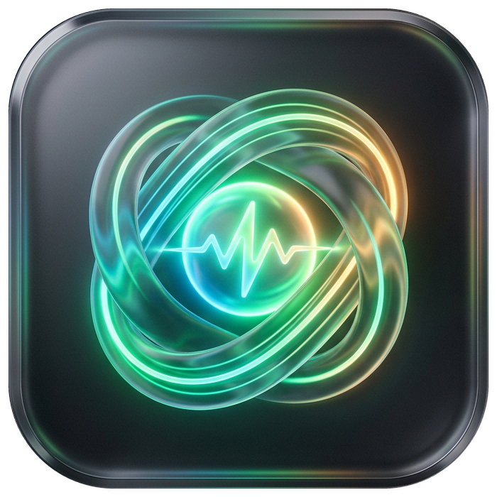

# ⚡ FerrisPulse · 灵脉 (跨品牌外设调度中心) v2.2.0

<p align="center">
  
</p>

<p align="center">
  <b>从一个鼠标，到一整张桌面 · 跨品牌直连 · 自动 8000Hz</b><br>
  <i>专为雷蛇、罗技、国产电竞外设打造的纯原生、极轻量 Windows 任务栏电量与硬件调度引擎</i>
</p>

<p align="center">
  <a href="https://github.com/Ferris-echo/FerrisPulse/releases"></a>
  <a href="https://github.com/Ferris-echo/FerrisPulse"></a>
  <a href="https://github.com/Ferris-echo/FerrisPulse"></a>
  <a href="https://github.com/Ferris-echo/FerrisPulse"></a>
  <a href="LICENSE"></a>
  <a href="https://signpath.io"></a>
</p>

---

## 📖 项目简介

**FerrisPulse · 灵脉**（原名《雷蛇电量管家》）诞生于一个纯粹的极客初衷：**彻底干掉官方动辄 1GB、常驻 10+ 后台守护服务的臃肿驱动全家桶**（如 Razer Synapse 雷云、Logitech G HUB 等）。

历经数月重构与底层硬件协议解构，2.0 时代正式蜕变为**跨品牌外设统一调度引擎**：
* ⚡ **极致轻量**：纯 C# 5.0 / Win32 原生调用，零第三方 DLL 依赖，常驻内存仅约 **12.8 MB**，CPU 占用长期 **0.00%**。
* 🎮 **8000Hz 独占感知**：日常 1000Hz 节能续航；进入 CS2、无畏契约、Apex 等全屏游戏瞬间毫秒级直切 4000Hz/8000Hz，退出游戏平滑回退。
* 🎯 **战术级穿透 OSD**：全屏游戏中调节 DPI / 回报率，右下角无感浮现战术 OSD 与柔和声效，绝不切回桌面、绝不吞枪、100% 穿透防误触。
* 🔋 **Win11 原生 Mica 美学**：暗黑圆角磨砂、任务栏原生彩色流光电量、多设备拖拽排序、独家智能静置休眠感知算法。

---

## 🐧 Linux 版（本仓库 `linux/`）

本仓库同时维护一个 **Linux 原生发行版**（Python 3 + GTK3 + AppIndicator，不走 Wine/.NET）：

| 项 | 内容 |
| --- | --- |
| 代码 | [linux/](linux/) |
| 首个适配设备 | Acer OMR331 旗舰版（XCTECH 2.4G 接收器 `249A:5C2F`），协议来自 PR #33 |
| 安装 | `sudo linux/scripts/install.sh`，或构建 `.deb`：`linux/scripts/build-deb.sh` |
| 验证 | `ferrispulse-linux --cli` → `Acer OMR331 旗舰版无线鼠标（R332） 电量 100% …` |
| 托盘 | `ferrispulse-linux --hidden`（GNOME 需启用 `ubuntu-appindicators@ubuntu.com`） |
| 范围 | 电量/充电/固件/型号/托盘/低电量通知；8000Hz、DPI、OSD 等 Windows 专属功能未移植 |

详见 [linux/README.md](linux/README.md)。

---

## 🏛️ 系统架构与硬核技术亮点 (Architecture & Highlights)

本项目完全采用现代模块化工程规范设计，适合作为桌面底层系统开发与软硬件交互的参考实践：

```
FerrisPulse/
├── src/
│   ├── Core/         # 单例守护、Win32 消息循环、注册表自启动守护、原子热更新
│   ├── Hardware/     # 底层 HID 通信、私有协议解构 (Razer 90B / Logitech HID++ / CompX)
│   ├── Models/       # 外设实体状态模型、配置持久化契约
│   ├── Services/     # 前台游戏焦点检测仲裁、回报率动态调度、非阻塞声效反馈
│   └── UI/           # Win11 Mica 窗体、GDI+ 高精度自绘引擎、零焦点穿透 OSD 浮窗
└── build.bat         # 纯原生构建脚本 (调用系统内置 csc.exe，零工具链安装成本)
```

### 1. 跨品牌硬件私有 HID 协议原生逆向直连
* **雷蛇 (Razer)**：解构专有 90 字节双向 Report 协议，直连 2.4G 接收器与有线通道，免开雷云实现毫秒级电量获取与回报率切换。
* **罗技 (Logitech)**：自研原生 **HID++ 1.0 / 2.0+** 协议引擎，握手 Lightspeed 与统一接收器，直接读取固件全称与精准百分比。
* **NuPhy (努斐)**：全系客制化键盘休眠超时调节、WinLock 锁、RGB 背光与无级亮度控制。
* **国产电竞矩阵 (CompX 方案)**：深度适配 ATK、VGN、VXE、迈从 (MCHOSE)、狼蛛 (AULA) 等国产主流 8K 无线鼠标。

### 2. 100% 反作弊安全的游戏焦点仲裁引擎
* **零内存读写，零 DLL 注入**：完全基于 Windows 原生 `GetForegroundWindow` 与 `GetWindowThreadProcessId` 进行进程特征比对。
* **严苛的仲裁机制**：内置 1200ms 窗口切换防抖、全屏独占排他性判断、浏览器与视频播放器防误触白名单，确保在高烈度竞技中绝不误判、绝无作弊封号风险。

### 3. 极速纯原生编译与零依赖设计
* 抛弃现代前端框架（Electron / Tauri）的数百兆开销，严格遵循 **C# 5.0 / .NET Framework 4.0** 语法基准。
* 只要是 Windows 10 / 11 操作系统，系统原生自带运行环境，解压单文件即可直接运行。

---

## 🛡️ 反作弊与安全性声明 (Anti-Cheat & Security FAQ)

> **问：在《无畏契约 (Valorant)》《CS2》《Apex 英雄》等竞技游戏中使用会被封号吗？**

**答：绝对不会。**
1. **纯标准 Windows API**：灵脉仅使用操作系统官方公开的 `user32.dll` 查询“当前哪个窗口在最前台”，就像 OBS 或 Discord 检测你是否在玩游戏一样。
2. **纯标准 HID 硬件通信**：切换回报率时，向鼠标发送的是该品牌鼠标固件公开支持的标准 HID 特征包，完全等同于你在官方驱动里点了一下“切换回报率”。
3. **零敏感行为**：本程序没有对任何游戏进程调用 `OpenProcess(PROCESS_VM_READ/WRITE)`，不挂任何 API Hook，不注入任何 DLL，代码全部开源接受全球开发者审计。

---

## 🛠️ 本地编译与构建 (Build from Source)

本项目无需安装几十 GB 的庞大 Visual Studio，仅需 Windows 原生自带的 .NET Framework 编译器即可构建：

```cmd
:: 1. 克隆代码仓库
git clone https://github.com/Ferris-echo/FerrisPulse.git
cd FerrisPulse

:: 2. 执行一键原生编译 (调用系统内置 csc.exe)
build.bat
```

编译完成后将在当前目录下直接生成高性能单文件可执行程序 `FerrisPulse.exe`。

---

## 🤝 参与贡献与设备适配 (Contributing)

我们非常欢迎社区极客共同丰富外设硬件支持库！

### 🤖 设备未被识别？用 AI Agent 做自己的开发者！(AI-Powered Adaptation)
找不到你的设备？**试试自己做自己的开发者！**  
你可以借助本地 AI Agent（如 DeepSeek Harness、Tencent Workbuddy、Google Antigravity、OpenAI Codex 等），让智能体直接阅读我们的工程源码并自动探测你物理连接的外设通信报文与电量指令，完成一站式极客适配！

👉 **查看完整中英双语 AI 适配指南与专属 Prompt：[AI 智能体专属外设适配指南 (docs/AI_DEVICE_ADAPTATION_GUIDE.md)](docs/AI_DEVICE_ADAPTATION_GUIDE.md)**

---

### 常规反馈方式
如果你手里有尚未支持的无线鼠标/键盘（如雷捷、玄派、蜻蜓等国产新方案）：
1. 欢迎在 **[Issues](https://github.com/Ferris-echo/FerrisPulse/issues)** 提交设备适配申请；
2. 提供你的设备型号、连接方式（2.4G/有线）以及设备硬件 ID（`VID` 与 `PID`）；
3. 若具备抓包能力，可提供 Wireshark / USBPcap 交互数据包，我们将以最快速度完成协议适配。

---

## 🏆 极客殿堂 · 社区硬核贡献者 (Hall of Fame & Contributors)

**FerrisPulse · 灵脉** 的生态飞轮与茁壮成长，离不开每一位开源极客的无私奉献与硬核探索！  
在此特别向以下为本项目主干贡献代码、深度协议抓包、逆向推演与底层根因排查的先锋贡献者致以最崇高的敬意：

| 极客贡献者 | 核心硬核贡献与适配成果 | 关联 Issue / PR |
| :--- | :--- | :--- |
| **[@jacky50403](https://github.com/jacky50403)** | 深度逆向推演索尼 **INZONE Buds (WF-G700N)** 64 字节 Output/Input Report 报文架构、左右耳及充电盒独立电量与 8 位累加和校验算法，引领音频外设生态突破 | [#22](https://github.com/Ferris-echo/FerrisPulse/issues/22) |
| **[@TonySen1](https://github.com/TonySen1)** | 极限排查罗技 Lightspeed (C547) 接收器双端点竞争、HID++ 2.0 Ping 命令根函数与 0x1004 统一电量解析，主导 **G502 X PLUS** 与罗技底层驱动重构 | [#15](https://github.com/Ferris-echo/FerrisPulse/issues/15) |
| **[@Afang555](https://github.com/Afang555)** | 独立编写并开源贡献**玄派玄熊猫 P1** (1K / 4K / 有线) 完整适配源码，推进国产新势力电竞外设生态 | [#21](https://github.com/Ferris-echo/FerrisPulse/issues/21) |
| **[@leviswhite527](https://github.com/leviswhite527)** | 提供**怒喵 AM Infinity .97** 62 字节 RACE 协议与 **ATK A9 AIR / X1 V2** 8K 报文资料，拓展客制化与超高回报率外设矩阵 | [#25](https://github.com/Ferris-echo/FerrisPulse/issues/25) |
| **群友“无情卍空虚”** | 独立研发并提交**赛睿 Arctis Nova 5 / 5X** 完整补丁，攻破 0x00B0 报文状态查询与解析，奠定赛睿音频外设生态 | 社区补丁贡献 |
| **群友“okbeng”** | USBPcap 逆向突破雷蛇**旋风黑鲨 V2 Pro 2.4G (BlackShark V2 Pro)** 64 字节中断端点 PA/PI 专属协议，并适配 DeathAdder V2 X HyperSpeed 14K | 社区贡献 |
| **群友“冰城”** | 深度逆向**迈从 A5 V2 Ultra** 三模电竞鼠标 WebHID 协议（电量、XY轴独立DPI与8K回报率）；再次奉献攻克**罗技 G PRO X Wireless** 耳机 HID++ 4.2 专属 0x1F20 ADC 毫伏放电曲线算法！ | 社区贡献 |
| **[@lililixxx1](https://github.com/lililixxx1)** | 真机实测并定版雷蛇 **Viper V3 HyperSpeed** 板载按键映射协议与底层 Hardware 驱动命令架构 | [#7](https://github.com/Ferris-echo/FerrisPulse/issues/7), [#13](https://github.com/Ferris-echo/FerrisPulse/issues/13) |

> 💡 **期待你的名字镌刻在此！**  
> 无论是一份 Wireshark 抓包报文、一次协议逆向推演，还是借助 AI 智能体写出的设备适配驱动，只要经过验证合入主干，你的名字都将被永久记录在灵脉开源殿堂中！

---

## 📄 开源许可证 (License)

本项目采用 **[GNU General Public License v3.0 (GPLv3)](LICENSE)** 协议开源。

* **自由分享与修改**：你可以自由使用、研究、修改并分发本项目代码；
* **开源传染性保护**：任何修改、衍生或整合本项目代码的二次开发作品，必须同样保持 **完全开源 (GPLv3)**；
* **严禁闭源商业牟利**：严禁任何商业实体将本项目代码闭源打包、嵌入商业流氓软件或转售牟利。让我们共同守护纯粹的开源极客精神！

---

<p align="center">
  <b>如果 FerrisPulse 对你的日常桌面有所帮助，欢迎在 GitHub 点亮一颗 ⭐️ Star 支持作者！</b><br>
  感谢每一位从 1.0《雷蛇电量管家》一路陪伴蜕变至今的玩家伙伴！
</p>
